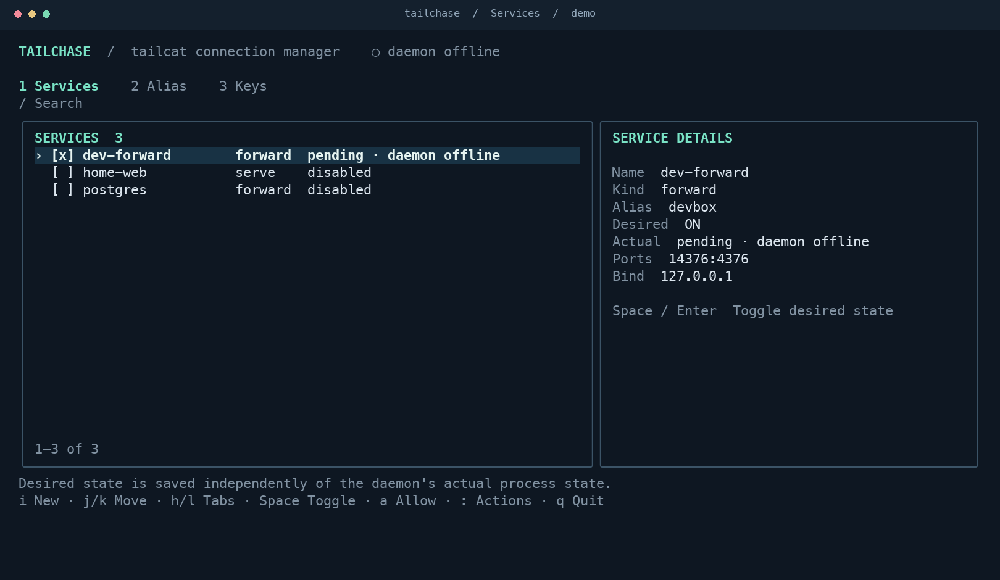
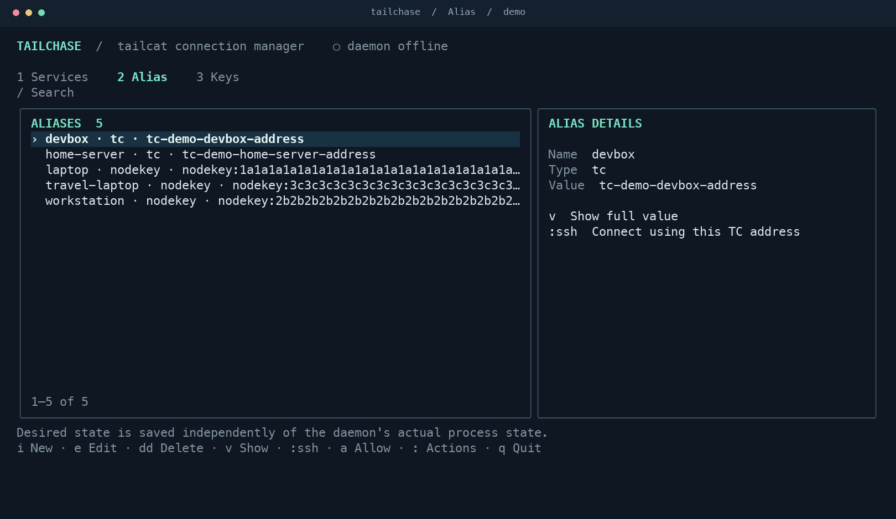
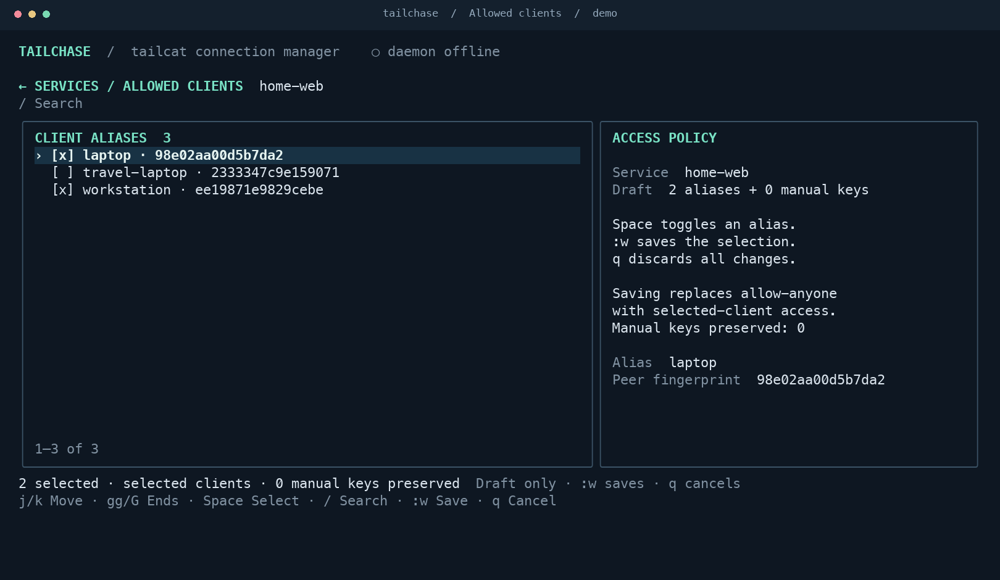

# tailchase

A Go CLI and TUI for managing [tailcat](https://github.com/tailscale/tailcat) addresses, local keys, and connection services.
Edit your address book with Vim-style controls and enable forward or serve services with checkboxes.



> Screenshots show the actual TUI running with sample data. The demo has no running daemon, so enabled services appear as `pending`.

## Installation

### Homebrew

```sh
brew tap hongzio/tap
brew install hongzio/tap/tailchase
```

Installs prebuilt executables for macOS and Linux on arm64 and amd64. **Users do not need Go installed.**
Homebrew installs `tailcat` as a runtime dependency.

The version's GitHub Release assets and tap formula must be published before installing through Homebrew.
Until then, use the source build instructions below.

```sh
tailchase tui
```

Start the Homebrew service to maintain persistent connections:

```sh
brew services start tailchase
brew services list
```

Update and restart the daemon:

```sh
brew update
brew upgrade hongzio/tap/tailchase
brew services restart tailchase
```

### Build from source

The development toolchain is managed with [mise](https://mise.jdx.dev/).
Install `tailcat` separately and make sure it is available on your PATH.

```sh
git clone git@github.com:hongzio/tailchase.git
cd tailchase
mise trust
mise install
mise run build
./bin/tailchase tui
```

Go is required only for source builds and release creation.

## Three tabs

| Tab | What it manages |
| --- | --- |
| **Services** | Forward and serve settings, desired state, actual process state, and allowed clients |
| **Alias** | An address book of `name + type + value` entries. Types are `tc` and `nodekey` |
| **Keys** | Local client/server private keys: generate, import from a file, and inspect. Existing tailcat keys appear automatically |

Managing Alias and Keys entries or exporting and importing your address book does not require a daemon.
The daemon runs enabled services and maintains their connections. It continues running after the TUI closes.

Local client keys are selected independently for each SSH connection or forward service.
You can use the same TC address with different local keys.

## Using the TUI

```sh
tailchase tui
```

A terminal size of **120 × 30** is recommended. The minimum is 50 × 16.

| Key | Action |
| --- | --- |
| `h` / `l` | Previous / next tab |
| `j` / `k` | Next / previous item or field |
| `gg` / `G` | First / last item |
| `Ctrl+d` / `Ctrl+u` | Half page down / up |
| `/` | Search; press `Enter` to browse results |
| `i` | Add an entry in the current tab |
| `e` | Edit the selected alias's name, type, and value |
| `dd` | Open deletion confirmation for the selected alias or managed key |
| `v` | Show details or the selected entry's TC address |
| `Space` | Toggle a service or checkbox |
| `a` | Choose allowed clients for a serve service |
| `:` | Search all actions or enter a command |
| `q` | Close or cancel the current panel; quit from the main screen |

Text fields use **INSERT** mode while you type.
Press `Esc` to return to **NORMAL** mode, move between fields with `j/k`, and press `i` to edit again.
Open choice fields with `Enter`, navigate with `j/k`, and confirm with `Enter`.

- **Save:** `Esc` → `:w` → `Enter`
- **Cancel:** `Esc` → `:q` → `Enter`
- **Run a command:** enter `:export`, `:import`, `:ssh`, `:status`, `:daemon`, or `:help`, then press `Enter`

## Alias address book



| Type | Value | Used for |
| --- | --- | --- |
| `tc` | A server connection address beginning with `tc` | SSH and forward destinations |
| `nodekey` | A public key: `nodekey:` followed by 64 hexadecimal digits | Allowed clients for serve services |

Press `i` in the Alias tab to enter **Name / Type / Value**.
Add public nodekeys directly to Alias; no prior registration in Keys is required.

```sh
# Replace tc... and nodekey:... with your actual address and public key.
tailchase alias add home --type tc --value 'tc...'
tailchase alias add laptop --type nodekey --value 'nodekey:...'
tailchase alias list
tailchase alias show home
```

Rename or delete an alias:

```sh
tailchase alias set home --name home-server
tailchase alias delete laptop
```

Renaming an alias updates service destination and allow-list references in the same operation.
Deleting a referenced alias or changing a nodekey used in an allow list is blocked, with the affected services listed in the error.
TC addresses may contain connection secrets; share them only with trusted recipients.

## Keys and access control

In Keys, press `i` and choose **Method `generate`** to create a local key or **`file`** to import an existing private-key JSON file.
The client/server role describes how a local key is used. Public nodekey aliases have no role.

```sh
tailchase key generate my-client --role client
tailchase key generate server --role server
tailchase key list
tailchase key show my-client
tailchase key show server
```

`key show` displays public metadata and a saved TC address when one can be recovered.
For keys with automatic relay selection, the saved address may be a template. Use `service show` to see a running server's address.
To reveal private material, explicitly use `key show NAME --private`.

Existing tailcat keys appear as names such as `tailcat:default` and `tailcat:client-default`.
Original tailcat key files are read-only in tailchase; use tailcat itself to delete them.

### Select allowed clients



1. On the connecting client, run `key show NAME` for the key it will use and copy the `public` value.
2. On the server, add that value to Alias with Type `nodekey`.
3. In Services, select the serve service and press `a`.
4. Select allowed aliases with `Space`, then save with `:w`.

Only nodekey aliases appear in the picker. An empty selection with no additional allowed keys **denies all clients**.

## Serve and port forwarding

### Expose a local port on the server

Register the client's public nodekey as an alias on the server, then create a serve service:

```sh
tailchase alias add laptop --type nodekey --value 'nodekey:...'
tailchase service add home-web \
  --kind serve \
  --server-key server \
  --ports 4376 \
  --allow laptop

tailchase enable home-web
brew services start tailchase
tailchase service show home-web
```

Serve uses **a local server key** and requires no destination TC alias.
Use `service show` or `v` in Services to inspect the running server's TC address.

### Connect from the client

Add the server's TC address as an alias, then create a forward service.
Select the local key whose public nodekey the server has allowed as `my-client`.

```sh
tailchase alias add home-server --type tc --value 'tc...'
tailchase service add dev-forward \
  --kind forward \
  --remote home-server \
  --client-key my-client \
  --ports 14376:4376

tailchase enable dev-forward
brew services start tailchase
```

`14376:4376` maps **`127.0.0.1:14376` on your computer → port `4376` on the remote server**.
New services start disabled. Enable them with `enable` or `Space` in the TUI.
Services displays the saved desired state separately from the actual process state.

### SSH

```sh
tailchase ssh home-server --user username --client-key my-client
```

In the TUI, select a TC alias and run `:ssh`.
Choose a username and local client key, then connect. Exiting SSH returns you to the TUI.
The destination's SSH service and access permissions must already be configured.

## Encrypted export and import

```sh
tailchase export --output aliases.tailchase
tailchase import aliases.tailchase --dry-run
tailchase import aliases.tailchase
```

The same operations are available through `:export` and `:import` in the TUI.

- **Export:** includes every alias and the TC addresses and public nodekeys available in Keys. Values derived from Keys are exported as unnamed entries.
- **Encryption:** enter a password twice when exporting and once when importing. Password input is masked.
- **Import:** skips values already present in local Keys and adds the remaining entries to Alias. Unnamed entries receive temporary names such as `unnamed-tc` and `unnamed-nodekey`.
- **Name conflicts:** preserves existing entries and adds a numeric suffix to incoming names. Reimporting the same file skips entries already imported.
- **Transfer scope:** only address-book names, types, and values are transferred. This format does not back up private keys or service configuration.

`--dry-run` decrypts and validates the import without saving changes. Enter the password again for the actual import.
Legacy plaintext bundles are unsupported; export them again using the new encrypted format.

## Daemon and configuration

As an alternative to Homebrew services, use `:daemon` in the TUI to start a background daemon, or run it in the foreground:

```sh
tailchase daemon
tailchase status
```

Choose either Homebrew services or a directly started daemon.
Only one daemon can run for a given configuration directory.

| Setting | Default location or override |
| --- | --- |
| macOS configuration | `~/Library/Application Support/tailchase/config.json` |
| Linux configuration | `$XDG_CONFIG_HOME/tailchase/config.json` or `~/.config/tailchase/config.json` |
| Configuration directory override | `TAILCHASE_CONFIG_DIR` |
| Native tailcat key directory override | `TAILCHASE_TAILCAT_KEYS_DIR` — an empty value disables discovery |

Configuration may contain managed private keys and is saved with mode 0600.
If an old daemon cannot read updated configuration after an upgrade, inspect `tailchase status` and restart it with the current binary.

## Development

```sh
mise run fmt
mise run test   # go test -race ./...
mise run check  # go vet ./...
```

The CLI and TUI share configuration validation and persistence. CI is configured to test on macOS, Linux, and Windows.
